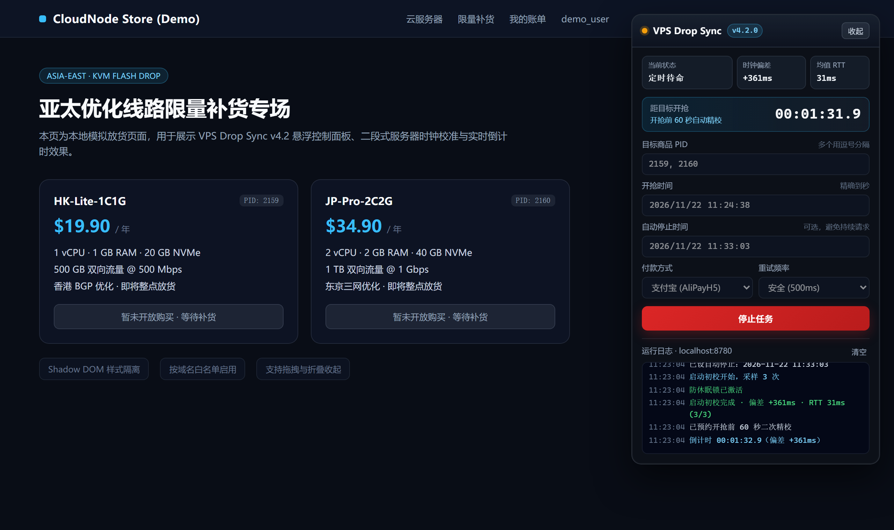

[简体中文](README.md) | English

<p align="center">
  
</p>

# VPS Drop Sync

A generic Tampermonkey userscript for time-synchronized VPS restock monitoring and automatic checkout.

VPS Drop Sync works on VPS and server provider sites that expose a compatible cart API. It reuses your existing browser session, polls one or more product PIDs at a scheduled time, dynamically parses the product configuration form, and attempts to add the item to the cart and complete checkout.

> The originally targeted provider has shut down, so this project has been refactored into a vendor-neutral userscript. Compatibility depends on the target site's cart endpoints rather than its brand name.

## One-Click Install

[Install VPS Drop Sync](https://raw.githubusercontent.com/1Beyond1/VPS-Drop-Sync/main/vps-drop-sync.user.js)

Requires a userscript manager such as Tampermonkey or Violentmonkey.

## UI Preview



> The floating control panel is mounted inside a Shadow DOM root for complete CSS isolation, featuring live telemetry metrics, a calibrated countdown board, task configuration inputs, and color-coded logs — with pointer drag positioning and one-click collapse into a compact capsule.

## Key Features

### Two-Stage Server Clock Calibration (with T-60s Timer Recalculation)

Designed to reduce clock drift between your local machine and the provider's restock clock:

1. **Initial calibration on start**: Immediately takes 3 consecutive `HEAD /` samples to correct the initial countdown.
2. **Pre-drop refinement & timer recalculation**: 60 seconds before the target time, takes 5 consecutive samples and **immediately recalculates and reschedules the 50 ms sprint timer using the updated `serverTimeDelta`**, eliminating trigger drift when local-to-server clock offset changes significantly.
3. **RTT midpoint estimation**: Each sample records send time, receive time, and the server's HTTP `Date` header, estimating the clock offset from the round-trip midpoint.
4. **Trimmed mean**: Samples are sorted by RTT, the fastest and slowest outliers are discarded, and the remaining samples are averaged to suppress jitter.
5. **High-frequency final countdown**: In the last 5 seconds, the countdown check interval tightens to 50 ms with a sprint highlight mode to minimize timer start latency.

The top telemetry bar and countdown board display live task status, calibrated clock offset, and average RTT in real time. Note that HTTP `Date` headers typically have 1-second granularity and may be altered by proxies or CDNs, so this mechanism reduces timing error rather than guaranteeing millisecond-exact precision.

### Per-Host Configuration, Quick Time Presets & Checkout Extensions

- **Per-host storage (`location.host`)**: Target PIDs, start/stop timestamps, payment method, retry interval, promo code, mute preference, dragged panel coordinates, and collapse state are stored independently per host so monitoring multiple providers simultaneously never overwrites settings.
- **Automatic legacy migration**: Upgrading from V4.2 or earlier seamlessly migrates legacy global GM keys into the per-host store on first read.
- **Quick time preset capsules**: One-click **Next Hour**, **+1m**, **+5m**, and **Stop=+3m** pills eliminate tedious second-level datetime picking.
- **Promo code & custom payment gateway**: Optional promo code field (submitted as `promo` during checkout) plus a **Custom Gateway...** option to specify any custom billing gateway code beyond Alipay, WeChat Pay, and PayPal.

### Multi-Channel Alerts on Order Lock & Abnormal Stop

- **Desktop notifications**: Uses `GM_notification` (with click-to-focus) and gracefully falls back to the standard Web `Notification` API.
- **Zero-asset Web Audio synthesis**: Generates distinct synthesized chimes via `AudioContext` for order lock success vs. abnormal/timeout stop, complete with a persisted mute toggle in the panel header and user-gesture audio unlock on Start to bypass browser autoplay blocks.
- **Tab title flashing & session-expiry detection**: Flashes `document.title` (automatically restored on focus) upon order lock, timeout stop, or detected login-page redirect so you never miss the invoice payment window while working in another tab.

### Shadow DOM Floating Panel & Security Hardening

- **Shadow DOM style isolation**: Encapsulates all panel markup and styling inside an open Shadow Root so host page CSS never breaks the panel and the panel never leaks styles into the site.
- **Drag positioning & collapsible capsule**: Drag the panel freely within viewport bounds from the header bar, or click **收起 / 展开** (Collapse / Expand) to fold it into a compact status pill; position and collapsed state persist per host.
- **Live telemetry bar & countdown board**: Three-column metric strip showing live status dot, clock offset, and average RTT, paired with a monospace (`tabular-nums`) 0.1-second countdown board that enters sprint highlight during the final 5 seconds.
- **Concise copy, inline validation & leveled logs**: Replaces blocking `alert` dialogs with an inline alert banner and automatic field focus; terminal-style logs are color-coded by severity, display the active hostname, and support one-click clearing.
- **Timer cleanup & security fixes**: Centralizes cleanup of all active timers on stop, timeout, or restart; renders values and log entries via safe DOM properties / `textContent` to prevent XSS; and generates a 14-character fallback password with `crypto.getRandomValues` whenever a form requires a blank `password` field.

### Additional Capabilities

- Polls multiple deduplicated PIDs sequentially in a loop.
- Reuses current browser cookies automatically — no manual credential copying.
- Dynamically parses product configuration forms (`input`, `select`, and `textarea` fields) without hard-coding plan-specific fields.
- Supports Alipay (`AliPayH5`), WeChat Pay (`wechatpay`), PayPal (`paypal`), and custom payment gateway codes.
- Configurable auto-start time (to the second) and optional auto-stop time.
- Three retry interval presets: `500ms` (Safe), `100ms` (Fast), and `10ms` (Extreme).
- Screen Wake Lock support to prevent the device from sleeping while waiting, with automatic re-acquisition when returning to the tab.
- Persists up to the latest 100 log entries across same-tab page navigations (`sessionStorage`).
- Verifies invoice URLs, fires multi-channel alerts, and automatically redirects to the generated invoice/payment page.

## Enabling on a Provider Site

The control panel is disabled everywhere by default. To enable it on a target site:

1. Install the userscript.
2. Log in to your target VPS provider website.
3. Click the Tampermonkey icon in your browser toolbar.
4. Select **"在当前网站启用 VPS Drop Sync（...）"** from the script menu.
5. The page reloads and the control panel appears in the top-right corner.

The allowlist is stored per `location.host` (hostname, including any non-default port). Enabling on `panel.example.com` does not enable on `www.example.com`; if product pages and checkout live on separate subdomains, enable each host individually.

To disable it on a site, choose **"在当前网站禁用 VPS Drop Sync（...）"** in the Tampermonkey menu.

Although the userscript metadata matches `http://*/*` and `https://*/*`, non-allowlisted sites only register the menu toggle — no panel is injected and no cart requests are sent.

## Checking Site Compatibility

The current version targets sites exposing the following same-origin cart endpoints:

```text
/cart?action=configureproduct&pid=<PID>
/cart?action=emptycart
/cart?action=viewcart&statuscart=checkout
```

The product configuration page must also contain a submittable `form` with `input`/`select` fields. Some WHMCS or custom-forked billing portals may be compatible, though visual similarity alone does not guarantee compatibility.

Always test the full flow first with an inexpensive, in-stock item. If a provider changes its endpoints, form fields, anti-abuse checks, or CAPTCHAs, the script will need site-specific adaptation.

## Finding Product PIDs

A PID is the numeric product ID in the cart system. The panel accepts one or more PIDs separated by commas, spaces, or `|`, for example:

```text
2159
2159,2160,2168
```

### Method 1: Inspect and probe the URL PID

Click any plan on the provider's site and check the address bar. A typical URL looks like:

```text
https://panel.example.com/cart?action=configureproduct&pid=2159
```

Modify the number after `pid=` and visit nearby IDs:

```text
https://panel.example.com/cart?action=configureproduct&pid=2160
https://panel.example.com/cart?action=configureproduct&pid=2161
```

If the page shows your target plan (even if currently out of stock), record that PID. If it redirects home, reports not found, or opens an unrelated plan, keep checking.

### Method 2: Record the PID during an earlier restock

If you do not know the PID ahead of time, observe one drop first without rushing to buy:

1. Open the configuration page when the plan appears.
2. Copy the `pid` value from the URL, purchase button link, or browser DevTools Network tab.
3. Save the PID for the next restock.
4. Before the next drop, fill in the PID, start time, stop time, and payment method in advance.
5. Start the script at least two minutes early so both the initial calibration and the T-60s refinement run.

## Usage

1. Sign in to the allowlisted provider site.
2. Enter one or more target PIDs (separated by commas, spaces, or `|`).
3. Set the auto-start time (accurate to the second).
4. Set an auto-stop time to avoid indefinite polling.
5. Choose the payment method and retry interval.
6. Click **"启动定时抢购"** (Start Scheduled Snipe).
7. Keep the tab open and network active; once redirected to the invoice page, verify your order and payment details.

Stick to the default **500 ms Safe mode**. The 100 ms and 10 ms presets generate much higher request volume and may trigger rate limits, CAPTCHAs, account restrictions, or IP bans; make sure you understand and follow the provider's rules.

## Workflow

```text
Read configuration
  → Initial clock calibration (3 samples)
  → T-60s refined calibration (5 samples)
  → Reach calibrated server time
  → Empty cart (/cart?action=emptycart)
  → Poll PID availability
  → Dynamically parse configuration form
  → POST add to cart
  → POST checkout
  → Verify invoice URL (viewinvoice / viewbilling / invoice)
  → Redirect to payment page
```

## Disclaimers

- Use only on accounts and provider sites you are authorized to access.
- Respect target sites' Terms of Service, purchase limits, and rate limits.
- This script does not bypass CAPTCHAs, login checks, payment confirmations, or server-side risk controls.
- Providers may use different checkout fields; always verify compatibility before relying on it.
- Automated checkout can create real orders, duplicate orders, or payment obligations — always set a stop time and review resulting invoices promptly.
- Success still depends on inventory, network latency, server load, and provider policies.

## Development & Testing

Core pure logic (time parsing & presets, per-host storage & legacy key migration, RTT calibration & T-60s timer recalculation, form extraction & checkout payload) can be verified locally with Node's zero-dependency built-in test runner:

```bash
node --check vps-drop-sync.user.js && node --test
```

## Release Notes

Current version: **V4.3.0**

### V4.3.0

- **Per-host storage & seamless migration**: Isolated PID, schedule timestamps, payment method, retry interval, promo code, mute state, panel coordinates, and collapse state by `location.host`, with automatic one-time migration from legacy global GM keys.
- **Quick time presets & checkout extensions**: Added **Next Hour**, **+1m**, **+5m**, and **Stop=+3m** preset pills, an optional promo code field (`promo`), and a custom payment gateway input.
- **Fixed T-60s sprint timer recalculation**: Immediately clears and reschedules the 50 ms precision sprint timer using the updated `serverTimeDelta` after T-60s secondary calibration completes.
- **Multi-channel alerts on lock & abnormal stop**: Added `@grant GM_notification` (with Web Notification fallback), zero-asset `AudioContext` synthesized chimes (with mute toggle and gesture unlock on Start), `document.title` flashing, and login-redirect session-expiry detection.
- **Automated tests & CI**: Added zero-dependency Node unit tests (`tests/`) and a GitHub Actions CI workflow.

### V4.2.0

- Rebuilt the floating control panel inside a Shadow DOM root for complete CSS isolation from host pages.
- Added header drag positioning (clamped to viewport bounds) and one-click collapse/expand into a compact capsule.
- Added a three-column live telemetry bar (status dot, clock offset, average RTT) and a 0.1-second countdown board with sprint highlight during the final 5 seconds.
- Streamlined UI copy and color-coded terminal logs, replacing blocking `alert` popups with inline form validation.
- Fixed timer cleanup across stop/restart lifecycles, eliminated unsafe `innerHTML` interpolation to mitigate XSS, and switched fallback password generation to 14-character CSPRNG strings via `crypto.getRandomValues`.

### V4.1.0

- Removed hard-coded domain and branding from the defunct provider and added per-host allowlisting via Tampermonkey menu commands.
- Retained and highlighted the two-stage server clock calibration workflow, switching the default retry interval to the safer `500ms` preset.
- Cleared default PID and expired timestamps, added required PID validation, GitHub auto-update URLs, and bilingual usage documentation.

## License

[MIT](LICENSE)
